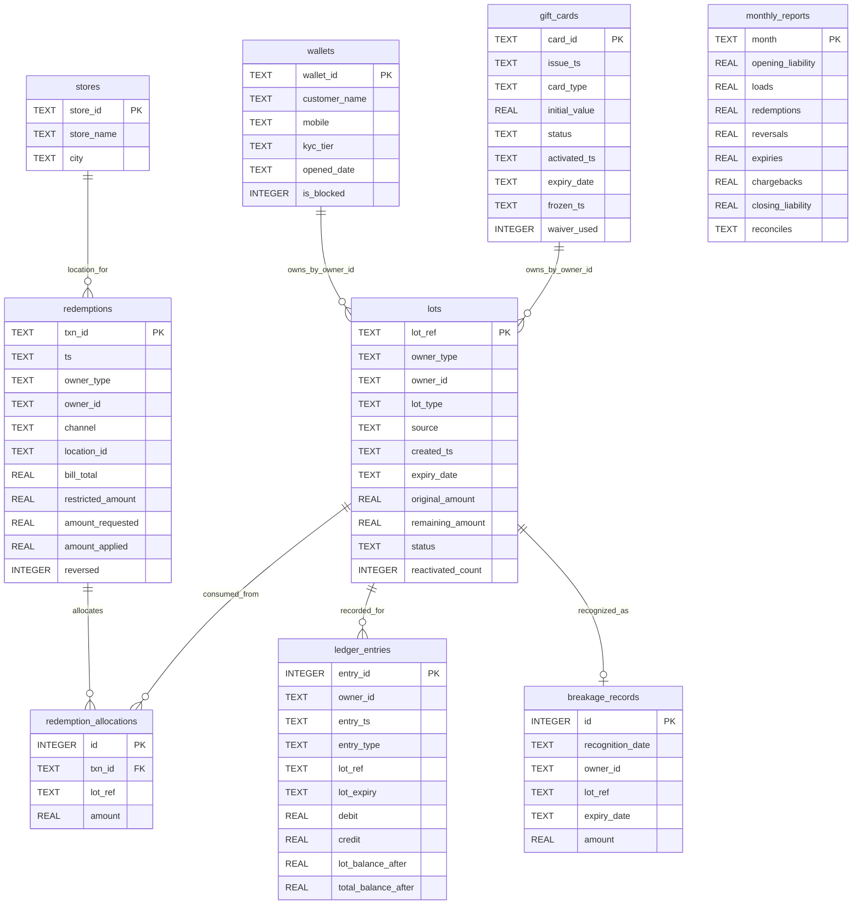
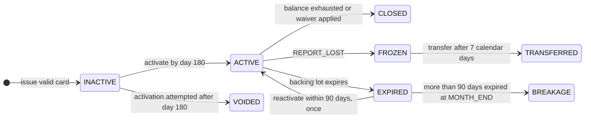

# Design Document

## Overview

The engine is a sequential batch processor. The CLI loads `stores.csv` and `wallets.csv`, then dispatches each command from `commands.txt` in source order. The processor mutates SQLite state, adds auditable ledger entries, and writes four CSV reports. Values are rounded and serialized to two decimal places. SQLite `REAL` columns store money; balances are not stored as integer paise.

## Glossary of Terms

| Term | Definition |
|---|---|
| Gift Card (Fixed/Open) | A stored-value card issued with a fixed denomination or an open denomination. It begins inactive and has a single backing card lot identified by its `card_id`; transferred cards receive a new ID and backing lot. |
| Wallet (MIN_KYC/FULL_KYC) | A customer account with a KYC tier that determines the applicable wallet holding and load limits. MIN_KYC has Rs 10,000 holding and monthly-load caps; FULL_KYC has a Rs 200,000 holding cap and a Rs 50,000 daily spend cap. |
| Lot (CARD/PAID/PROMO/REVERSAL) | A balance tranche with an owner, creation time, original and remaining amount, and expiry date. CARD backs a gift card; PAID and PROMO represent wallet loads; REVERSAL represents a later-day refund tranche. |
| FEFO Allocation | First-expiring-first-out allocation: eligible lots are consumed by earliest expiry, with creation time breaking expiry ties. PROMO lots are prioritized ahead of other lots. |
| Breakage | An unspent positive lot balance recognized after its expiry grace period has elapsed. |
| Liability Reconciliation | A month-end comparison of closing active liability with opening liability plus loads, reversals, less redemptions, expiries, and chargebacks. |
| Chargeback Clawback | Reversing the full original amount of an eligible wallet load. If part of the lot was spent, its remaining balance becomes negative by the consumed amount and the wallet is blocked from redemption until top-ups offset the debt. |
| Small-Balance Waiver | A one-time card rule: when the available card balance is below Rs 10, the card pays its remaining balance toward a redemption, waives the shortfall, and closes. |

## Architecture and Data Model

The CLI in `src/main.py` selects input and output directories. `run_pipeline` in `src/processor.py` initializes the schema, imports master data, processes commands, and writes reports. `src/database.py` owns connection and schema setup. The processor records redemption allocations separately from ledger entries so reversal logic can identify the source lots.

The diagram shows logical relationships. The schema declares a foreign key only from `redemption_allocations.txn_id` to `redemptions.txn_id`; lot ownership and lot references are polymorphic/string references rather than enforced foreign keys. `stores` is used as the location source for physical-store redemptions; `ONLINE` is a virtual location value.

## Gift Card and Lot Lifecycle

This is a conceptual lifecycle combining the card and its backing lot. In the database, `gift_cards.status` does not have `EXPIRED` or `BREAKAGE`; those statuses belong to `lots`. When the backing lot expires, the card record itself is not automatically changed to an expired status.

## Business-Rule Register

“No decision row” means the current CSV decision contract does not emit a row for that command, even when a card state change occurs.

| Rule ID | Description | Trigger condition | Exact outcome / reason code |
|---|---|---|---|
| BR-01 | Validate card issuance denomination and type. | `ISSUE` value is below Rs 100, above Rs 10,000, or not a multiple of Rs 50; or card ID already exists. | Invalid or duplicate issue is ignored; no decision row. Valid issue creates an `INACTIVE` card and inactive CARD lot. |
| BR-02 | Enforce the activation window and card expiry. | `ACTIVATE` is submitted for an inactive card. | Day 180 from issue date is valid; activation sets ACTIVE and expiry to activation date + 365 days. After day 180, set VOIDED and close the backing lot at zero. No decision row. |
| BR-03 | Enforce wallet load limits and unique load references. | `LOAD_WALLET`, including `BALANCE_TO_10000`. | MIN_KYC: Rs 10,000 holding and calendar-month gross-load caps. FULL_KYC: Rs 200,000 holding cap. Accepted load is APPROVED/`OK`; violations are DECLINED/`HOLDING_LIMIT` or `MONTHLY_LOAD_LIMIT`; invalid amount/ref/wallet use `INVALID_AMOUNT`, `DUPLICATE_REF`, or `INVALID_WALLET`. Literal load computes the positive amount needed to bring the balance to Rs 10,000. |
| BR-04 | Assign load-lot expiry. | Accepted wallet load. | PROMO expiry is load date + 90 days; PAID expiry is load date + 365 days. A lot remains redeemable on its expiry date and expires after that date. |
| BR-05 | Validate redemption target, card state, wallet block, PIN, and transaction uniqueness. | `REDEEM` uses a duplicate transaction ID, invalid or inactive target, frozen card, blocked wallet, or ONLINE card redemption without a valid PIN. | DECLINED with `DUPLICATE_TXN`, `INVALID_CARD`, `INVALID_WALLET`, `NOT_ACTIVATED`, `CARD_INACTIVE`, `CARD_FROZEN`, `WALLET_BLOCKED`, `PIN_REQUIRED`, or `INVALID_PIN`, as applicable. |
| BR-06 | Cap stored-value contribution to restricted-goods bills. | `restricted_amount > 0` and requested value exceeds 70% of bill total. | Approve the capped amount as PARTIAL/`RESTRICTED_CAP_70`; remainder is paid by another tender. |
| BR-07 | Allocate redemptions to eligible lots. | Valid redemption with available funds. | Consume PROMO lots first, then FEFO by expiry date and creation time. Lots expiring today remain eligible. |
| BR-08 | Handle insufficient balance and one-time small-card waiver. | Requested/capped amount exceeds balance, or available CARD balance is below Rs 10 and waiver is unused. | Insufficient balance is DECLINED/`INSUFFICIENT_FUNDS`. Otherwise apply the remaining card balance, waive the shortfall once, and close the card with PARTIAL/`SMALL_BALANCE_WAIVER`. |
| BR-09 | Enforce daily redemption velocity and FULL_KYC spend cap. | Card would exceed five approved redemptions in a calendar day, or FULL_KYC wallet's current-day applied spend plus request exceeds Rs 50,000. | Decline with `VELOCITY`; a new calendar day starts a fresh count. |
| BR-10 | Reverse a redemption using its original allocation. | `REVERSE` references a known, not-yet-reversed redemption. | Same-day reversal restores the exact original lots; later reversal creates REVERSAL lots with original expiry. Portions whose expiry date has passed are skipped. Result uses `OK`, `PARTIAL_EXPIRED`, or `LOT_EXPIRED`; invalid/already-reversed uses `INVALID_OR_REVERSED`. |
| BR-11 | Apply load chargebacks within the recovery window. | `CHARGEBACK` is requested no more than 120 calendar days after load. | Claw back the full original lot value and report APPROVED/`OK`; consumed value becomes a negative lot and blocks redemptions. Later top-ups offset debt before becoming new spendable balance. Invalid/repeated lot uses `INVALID_LOT`; day 121+ uses `OUTSIDE_WINDOW`. |
| BR-12 | Reactivate an expired lot at most once during its grace period. | `REACTIVATE` targets an EXPIRED lot; expiry-age is measured in calendar days. | Day 90 is valid: deduct 10% fee, restore 90%, and set expiry to six months after reactivation. Day 91+ is DECLINED/`GRACE_EXPIRED`; repeat is `ALREADY_REACTIVATED`; non-expired/missing is `NOT_EXPIRED`. |
| BR-13 | Freeze reported-lost cards. | `REPORT_LOST` targets an ACTIVE or INACTIVE card. | Set card state to FROZEN; subsequent redemption is declined with `CARD_FROZEN`. The command does not create a decision row. |
| BR-14 | Transfer a lost card after the quiet period. | `TRANSFER_LOST` targets a frozen card and proposes a new card ID. | Fewer than 7 calendar days is DECLINED/`TOO_EARLY`; not frozen is `NOT_FROZEN`; duplicate new ID is `DUPLICATE_CARD`. After 7 days, transfer the balance less min(Rs 50, balance), preserve expiry, mark old card TRANSFERRED, and return APPROVED/`OK`. |
| BR-15 | Expire lots and recognize breakage at month end. | `MONTH_END|YYYY-MM` reaches the end of a month. | Expire ACTIVE lots whose expiry is on or before the month end. Move positive remaining expired value to BREAKAGE when it is more than 90 days past expiry; record recognition on the month's last date. No decision row. |
| BR-16 | Keep an auditable ledger and emit the specified reports. | Accepted financial operation, `PRINT_STATEMENT`, or report print/month-end command. | Record debit/credit and post-entry lot/account balances; statement/report headers and order follow the README schemas. Month-end `reconciles` is `true` when opening + loads - redemptions + reversals - expiries - chargebacks equals closing liability within Rs 0.02, otherwise `false`. |

### Sample-Pack Consistency Note

The command file is authoritative and is processed strictly in order; planted scenario annotations are not hardcoded overrides. In this pack, WAL-001 already has a balance of Rs 9,000 before the annotated Rs 6,000 load, so that load is rejected and `BALANCE_TO_10000` loads Rs 1,000. WAL-003 is at its MIN_KYC holding limit before the annotated EC5B Rs 800 load, so EC5B is rejected. WAL-005's EC6C promo lot is fully spent before its day-91 reactivation command, so the rejection has no remaining positive amount to recognize as breakage.